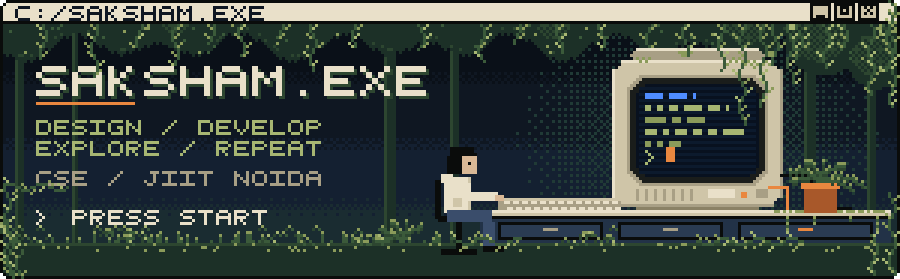
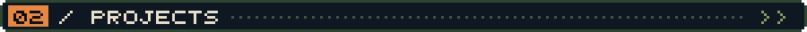
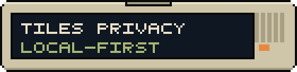
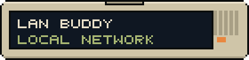
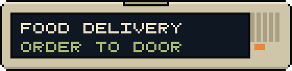
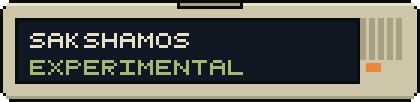

<div align="center">



<br><br>



</div>

<br><br>


<br>

**Saksham Gupta** · CSE @ JIIT Noida · designer + developer

```text
> I design interfaces, then immediately start wondering how to implement them.
> Currently building things, breaking things, and occasionally fixing them.
> Open source enjoyer. Pixel art hobbyist. Professional overthinker.
```

<sub>Into: UI/UX · frontend · full-stack · open source · pixel art · experimental software</sub>

<div align="center">

<b>DESIGN</b> wireframes → interfaces → pixels &nbsp;&nbsp; ◆ &nbsp;&nbsp; <b>DEVELOP</b> components → APIs → systems

</div>

<br>



<br>

<p>
<a href="https://github.com/Sakshamcozykun/ShareSplit"></a>
<a href="https://github.com/Sakshamcozykun/Kamui"></a>
<a href="https://github.com/Sakshamcozykun/GoogleClasroom-Bulk-downloader"></a>
<a href="https://github.com/Sakshamcozykun/rootquest"></a>
</p>

**[ShareSplit](https://github.com/Sakshamcozykun/ShareSplit)** · expense sharing · groups · UPI settlements · [VIEW REPOSITORY →](https://github.com/Sakshamcozykun/ShareSplit)<br>
**[Kamui](https://github.com/Sakshamcozykun/Kamui)** · Go CLI · movies, music, books in terminal · [VIEW REPOSITORY →](https://github.com/Sakshamcozykun/Kamui)<br>
**[Google Classroom Bulk Downloader](https://github.com/Sakshamcozykun/GoogleClasroom-Bulk-downloader)** · Chrome extension · bulk download attachments · [VIEW REPOSITORY →](https://github.com/Sakshamcozykun/GoogleClasroom-Bulk-downloader)<br>
**[RootQuest](https://github.com/Sakshamcozykun/rootquest)** · CTF platform · per-user dynamic flags · [VIEW REPOSITORY →](https://github.com/Sakshamcozykun/rootquest)

<br>


<br>

<sub>EQUIPPED</sub>

`LANGUAGES` &nbsp;`C++` &nbsp; &nbsp;`Python` &nbsp; &nbsp;`JavaScript` &nbsp; &nbsp;`HTML/CSS` &nbsp; &nbsp;`PHP`<br>
`WEB      ` &nbsp;`React` &nbsp; &nbsp;`Next.js` &nbsp; &nbsp;`Tailwind` &nbsp; &nbsp;`FastAPI` &nbsp; &nbsp;`Node.js` &nbsp; &nbsp;`MySQL`<br>
`TOOLS    ` &nbsp;`Git` &nbsp; &nbsp;`GitHub` &nbsp; &nbsp;`Photoshop` &nbsp; &nbsp;`Aseprite` &nbsp; &nbsp;`Figma`

<br>


<br>

<p align="center">
<br>
<sub>Redrawn every 6 hours by a GitHub Action from the contribution calendar.</sub>
</p>

<br>


<br>

[GitHub](https://github.com/Sakshamcozykun) · [LinkedIn](https://www.linkedin.com/in/saksham-gupta) · [Email](mailto:sakshamgupta.cozykun@gmail.com)

```text
SYSTEM STATUS

DESIGN      [OK]
CODE        [OK]
COFFEE      [LOW]
SLEEP       [ERROR]

> thanks for visiting my RAM
> connection terminated
> ideas still running_
```
